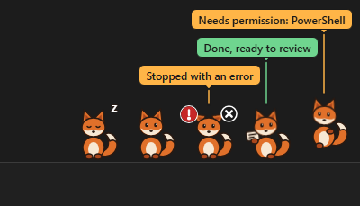

# Knock

Knock shows each running [Claude Code](https://docs.claude.com/en/docs/claude-code/overview) session as a small animal on your Windows taskbar. When a session needs you, its animal knocks. Click it to jump to that session.



> **Beta.** This is v0.3, a public test version. Expect rough edges, and please [tell us how it went](#feedback).

## What it does

- **One animal per session**: a fox, rabbit, cat or owl. Or switch to plain colored labels in Settings.
- **Knocks only when it matters**: one notification when a session needs permission or has a question, and one reminder after 5 minutes. Errors show a red mark. Finished sessions hold up a "done" card quietly.
- **Hover** an animal to see the project, what it's waiting for and for how long.
- **Click** an animal to bring its terminal or editor to the front.
- **More than 5 sessions?** The extras wait in a little den that shows how many are in each state.
- **While you were away**: back after 10 minutes? A card lists what finished, failed or needs you.
- **Pause and quiet hours** for notifications.
- Respects Windows **Animation effects**, works with Narrator, and handles 100-200% scaling, auto-hiding taskbars and multiple monitors.


## Requirements

- **Windows 11.**
- **The Claude Code CLI running natively on Windows** (PowerShell, Command Prompt or Git Bash, in any terminal or editor).
- **Not supported:** WSL, the Claude Code panel in VS Code, and the Claude desktop app.

## Install

1. Download `Knock_0.3.0-beta.1_x64-setup.exe` from the [Releases page](https://github.com/bandaranayake/knock/releases).
2. Run it. It installs for your user only, with no administrator rights.
3. Follow the short setup.

The installer is **unsigned**, so Windows may warn you (click **More info**, then **Run anyway**). If **Smart App Control** is on, Windows won't run Knock, and we don't suggest turning it off to use this. If you'd rather not run an unsigned installer, you can [build Knock yourself](#build-from-source).

## What setup changes

- Setup **shows you exactly what it will add** to `%USERPROFILE%\.claude\settings.json` (or the folder in `CLAUDE_CONFIG_DIR`) and writes nothing until you click **Confirm**.
- It **backs up** the file first, to `%APPDATA%\Knock\backups`, and keeps every other setting you have.
- Sessions that are already open connect within about 10 seconds. No restart needed.
- **Settings → Remove Knock from Claude Code** takes the hooks out again with one click.

If Knock isn't running, Claude Code carries on normally. The hooks fail quickly and silently.

## Privacy

Knock never reads your conversations, prompts or code. No telemetry, no accounts, no internet. Everything stays on your computer.

## Uninstall

1. Open Knock's **Settings** (tray icon) and click **Remove Knock from Claude Code**.
2. Uninstall **Knock** from **Windows Settings → Apps → Installed apps**.

Do step 1 first. If you skip it, Knock's hooks stay in Claude Code's settings. They're harmless (they fail silently), but they're clutter.

## Feedback

- **[Send a setup report](https://github.com/bandaranayake/knock/issues/new?template=setup-report.yml)**, even if everything went fine.
- **[Report a bug](https://github.com/bandaranayake/knock/issues/new?template=bug-report.yml)**.

## Build from source

Knock is a [Tauri 2](https://v2.tauri.app/) app with a Rust core and a TypeScript overlay drawn with PixiJS. You need Rust, Node.js, pnpm and the [Tauri prerequisites for Windows](https://v2.tauri.app/start/prerequisites/).

```
pnpm install --frozen-lockfile
pnpm build
```

The installer appears in `target\release\bundle\nsis\`.

## License

[MIT](LICENSE)
