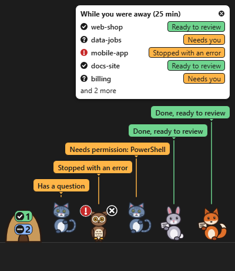

<div align="center">


<p><b>Your Claude Code sessions, living on your Windows taskbar.</b><br>
When a session needs you, its animal knocks. Click it to jump straight there.</p>

<p>
<a href="https://github.com/bandaranayake/knock/releases"></a>

<a href="https://docs.claude.com/en/docs/claude-code/overview"></a>
<a href="https://v2.tauri.app/"></a>
<a href="LICENSE"></a>
</p>

<p>
<sub>Linux port of <a href="https://github.com/bandaranayake/knock">Knock</a> by Isuru Bandaranayake. The license stays MIT, with the original copyright. Windows downloads and the original release notes live in the <a href="https://github.com/bandaranayake/knock">original repo</a>.</sub>
</p>


<p>
<a href="#linux"><b>Linux</b></a> ·
<a href="#install"><b>Install</b></a> ·
<a href="#what-it-does"><b>Features</b></a> ·
<a href="#privacy"><b>Privacy</b></a> ·
<a href="#feedback"><b>Feedback</b></a>
</p>

</div>

> [!NOTE]
> **Beta.** This is v0.3, a public test version. Expect rough edges, and please [tell us how it went](#feedback).

## What it does

- 🦊 **One animal per session**: a fox, rabbit, cat or owl. Or switch to plain colored labels in Settings.
- 🚪 **Knocks only when it matters**: one notification when a session needs permission or has a question, and one reminder after 5 minutes. Errors show a red mark. Finished sessions hold up a "done" card quietly.
- 🔍 **Hover** an animal to see the project, what it's waiting for and for how long.
- 🖱️ **Click** an animal to bring its terminal or editor to the front.
- 🏠 **More than 5 sessions?** The extras wait in a little den that shows how many are in each state.
- 📋 **While you were away**: back after 10 minutes? A card lists what finished, failed or needs you.
- 🌙 **Pause and quiet hours** for notifications.
- ♿ Respects Windows **Animation effects**, works with Narrator, and handles 100-200% scaling, auto-hiding taskbars and multiple monitors.

<p align="center">

</p>

## Linux

Knock on Linux shows each Claude Code session as an animal that knocks when it needs you. What you get depends on your desktop: on KDE Plasma it is a strip above the panel, on GNOME it is a tray icon and notifications.

### Install on Arch or CachyOS

Knock is not in the AUR yet (planned). For now, from the `packaging/aur` folder of this repo, run:

```
makepkg -si
```

The package is named `knock-claude-git`. An AppImage is planned, not available yet.

### Desktops

| Desktop | What works |
|---|---|
| KDE Plasma on Wayland | **Verified.** Strip above the panel. Click an animal to jump to its terminal window. |
| Hyprland, Sway | Code written, not tested yet. |
| X11 | Code written, not tested yet. |
| GNOME on Wayland | Tray icon and notifications only. No strip. |

### Agents

- **Claude Code**: supported.
- **Antigravity CLI (`agy`)**: beta, partly working. It cannot show permission knocks.
- **Codex CLI and Copilot CLI**: not available yet (untested).

### Sprite packs

Pick a pack in **Settings → Characters**. A pack is one `.knockpack` file. To add one, double-click the file, or use **Add a pack…**.

### Known limits

- The Windows build has only been type-checked in this port. It has not been run.
- On NVIDIA graphics under Wayland, a possible workaround is to start Knock with `WEBKIT_DISABLE_DMABUF_RENDERER=1` set. This is not confirmed.

Report Linux issues at [github.com/1Ashes3/knock/issues](https://github.com/1Ashes3/knock/issues).

## Requirements

- **Windows 11.**
- **The Claude Code CLI running natively on Windows** (PowerShell, Command Prompt or Git Bash, in any terminal or editor).
- **Not supported:** WSL, the Claude Code panel in VS Code, and the Claude desktop app.

## Install

1. Download `Knock_0.3.0-beta.1_x64-setup.exe` from the [Releases page](https://github.com/bandaranayake/knock/releases).
2. Run it. It installs for your user only, with no administrator rights.
3. Follow the short setup.

> [!WARNING]
> The installer is **unsigned**, so Windows may warn you (click **More info**, then **Run anyway**). If **Smart App Control** is on, Windows won't run Knock, and we don't suggest turning it off to use this. If you'd rather not run an unsigned installer, you can [build Knock yourself](#build-from-source).

## What setup changes

- Setup **shows you exactly what it will add** to `%USERPROFILE%\.claude\settings.json` (or the folder in `CLAUDE_CONFIG_DIR`) and writes nothing until you click **Confirm**.
- It **backs up** the file first, to `%APPDATA%\Knock\backups`, and keeps every other setting you have.
- Sessions that are already open connect within about 10 seconds. No restart needed.
- **Settings → Remove Knock from Claude Code** takes the hooks out again with one click.

If Knock isn't running, Claude Code carries on normally. The hooks fail quickly and silently.

## Privacy

Knock never reads your conversations, prompts or code. No telemetry, no accounts, no internet. Everything stays on your computer.

## Uninstall

1. Open Knock's **Settings** (tray icon) and click **Remove Knock from Claude Code**.
2. Uninstall **Knock** from **Windows Settings → Apps → Installed apps**.

> [!TIP]
> Do step 1 first. If you skip it, Knock's hooks stay in Claude Code's settings. They're harmless (they fail silently), but they're clutter.

## Feedback

- **[Send a setup report](https://github.com/bandaranayake/knock/issues/new?template=setup-report.yml)**, even if everything went fine.
- **[Report a bug](https://github.com/bandaranayake/knock/issues/new?template=bug-report.yml)**.

## Build from source

Knock is a [Tauri 2](https://v2.tauri.app/) app with a Rust core and a TypeScript overlay drawn with PixiJS. You need Rust, Node.js, pnpm and the [Tauri prerequisites for Windows](https://v2.tauri.app/start/prerequisites/).

```
pnpm install --frozen-lockfile
pnpm build
```

The installer appears in `target\release\bundle\nsis\`.

## License

[MIT](LICENSE)
