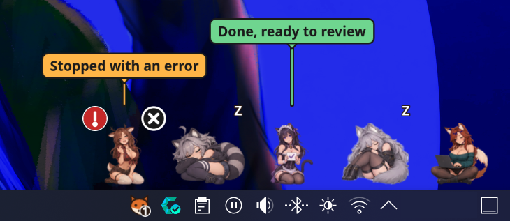
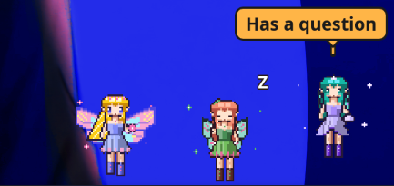

<div align="center">


<p><b>Your Claude Code sessions, living on your Linux desktop.</b><br>
When a session needs you, its animal knocks. Click it to jump straight there.</p>

<p>

<a href="https://docs.claude.com/en/docs/claude-code/overview"></a>
<a href="https://v2.tauri.app/"></a>
<a href="LICENSE"></a>
</p>

<p>
<sub>Linux port of <a href="https://github.com/bandaranayake/knock">Knock</a> by Isuru Bandaranayake. The license stays MIT, with the original copyright. <b>Looking for Windows? Use the <a href="https://github.com/bandaranayake/knock">original repo</a>:</b> this fork is Linux only.</sub>
</p>



<p>
<a href="#linux"><b>Linux</b></a> ·
<a href="#install-on-arch-or-cachyos"><b>Install</b></a> ·
<a href="#sprite-packs"><b>Sprite packs</b></a> ·
<a href="#what-it-does"><b>Features</b></a> ·
<a href="#privacy"><b>Privacy</b></a> ·
<a href="#feedback"><b>Feedback</b></a>
</p>

</div>

> [!NOTE]
> **Beta.** This is v0.1 for Linux, a test version. Expect rough edges, and please [tell us how it went](#feedback).

## What it does

- 🦊 **One animal per session**: a fox, rabbit, cat or owl. Or switch to plain colored labels in Settings.
- 🚪 **Knocks only when it matters**: one notification when a session needs permission or has a question, and one reminder after 5 minutes. Errors show a red mark. Finished sessions hold up a "done" card quietly.
- 🔍 **Hover** an animal to see the project, what it's waiting for and for how long.
- 🖱️ **Click** an animal to bring its terminal window to the front.
- 🏠 **More than 5 sessions?** The extras wait in a little den that shows how many are in each state.
- 🌙 **Pause and quiet hours** for notifications.
- 🖥️ Handles scaling and multiple monitors.

## Linux

Knock on Linux shows each Claude Code session as a character that knocks when it needs you. What you get depends on your desktop: on KDE Plasma it is a strip above the panel, on GNOME it is a tray icon and notifications.

<p align="center">

</p>

### Requirements

- Linux with a desktop from the table below.
- The **Claude Code CLI** running in a terminal.

### Install on Arch or CachyOS

Knock is not in the AUR yet (planned). For now, from the `packaging/aur` folder of this repo, run:

```
makepkg -si
```

The package is named `knock-claude-git`. An AppImage builds with `pnpm tauri build --bundles appimage`; a download is coming with the first release.

### Desktops

| Desktop | What works |
|---|---|
| KDE Plasma on Wayland | **Verified.** Strip above the panel. Click an animal to jump to its terminal window. |
| Hyprland, Sway | Code written, not tested yet. |
| X11 | Code written, not tested yet. |
| GNOME on Wayland | Tray icon and notifications only. No strip. |

### Agents

- **Claude Code**: supported.
- **Antigravity CLI (`agy`)**: beta, partly working. It cannot show permission knocks.
- **Codex CLI and Copilot CLI**: not available yet (untested).

### Known limits

- On NVIDIA graphics under Wayland, a possible workaround is to start Knock with `WEBKIT_DISABLE_DMABUF_RENDERER=1` set. This is not confirmed.
- The "While you were away" card, which is meant to appear after 10 minutes of no input, comes from the original and has not been tested on Linux.

Windows is not supported in this fork. For Windows, use the [original Knock](https://github.com/bandaranayake/knock).

Report Linux issues at [github.com/1Ashes3/knock/issues](https://github.com/1Ashes3/knock/issues).

## Sprite packs

A sprite pack changes the whole cast of characters. Knock ships with a few built-in packs, and you can add your own.

<p align="center">

</p>

- **Choose a pack:** open **Settings → Characters**.
- **Add a pack:** a pack is one `.knockpack` file. Double-click it, drop it on the Settings window, or use **Add a pack…**.
- **See a pack in action:** choose **Introduce sprites** in the tray menu. Every character appears asleep, then four act out the states (sleeping, working, knocking, failed, done) for about 18 seconds.
- **Make your own:** the exact formats, file names, size limits and checks are in **[art/PACKS.md](art/PACKS.md)**. It covers drawn (SVG) characters, sprite-sheet (PNG) characters, custom animations, and how to check and build a `.knockpack` file with `knock pack check` and `knock pack build`.

## What setup changes

- Setup **shows you exactly what it will add** to `~/.claude/settings.json` (or the folder in `CLAUDE_CONFIG_DIR`) and writes nothing until you click **Confirm**.
- It **backs up** the file first, to `~/.config/knock/backups` (the newest 5 are kept), and keeps every other setting you have.
- Sessions that are already open connect within about 10 seconds. No restart needed.
- **Settings → Remove Knock from Claude Code** takes the hooks out again with one click.

If Knock isn't running, Claude Code carries on normally. The hooks fail quickly and silently.

## Privacy

Knock never reads your conversations, prompts or code. No telemetry, no accounts, no internet. Everything stays on your computer.

## Uninstall

1. Open Knock's **Settings** (tray icon).
2. Remove Knock from every agent you connected:
   - **Claude Code:** click **Remove Knock from Claude Code**.
   - **Other agents** (Antigravity and the rest): under **Other agents**, click **Remove…** next to each one you connected, then confirm.
3. Turn off **Launch at sign-in**.
4. Remove the package with `sudo pacman -R knock-claude-git`, or delete the AppImage.

> [!TIP]
> Do steps 1 to 3 first. If you skip them, Knock's hooks stay in each agent's settings. They're harmless (they fail silently), but they're clutter.

## Feedback

- **[Send a setup report](https://github.com/1Ashes3/knock/issues/new?template=setup-report.yml)**, even if everything went fine.
- **[Report a bug](https://github.com/1Ashes3/knock/issues/new?template=bug-report.yml)**.

## Build from source

Knock is a [Tauri 2](https://v2.tauri.app/) app with a Rust core and a TypeScript overlay drawn with PixiJS. You need Rust, Node.js, pnpm and the [Tauri prerequisites for Linux](https://v2.tauri.app/start/prerequisites/), plus `gtk-layer-shell`.

```
pnpm install --frozen-lockfile
pnpm tauri build --bundles appimage
```

The AppImage appears in `target/release/bundle/appimage/`.

## License

[MIT](LICENSE)
